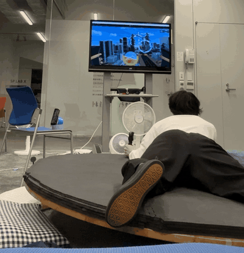
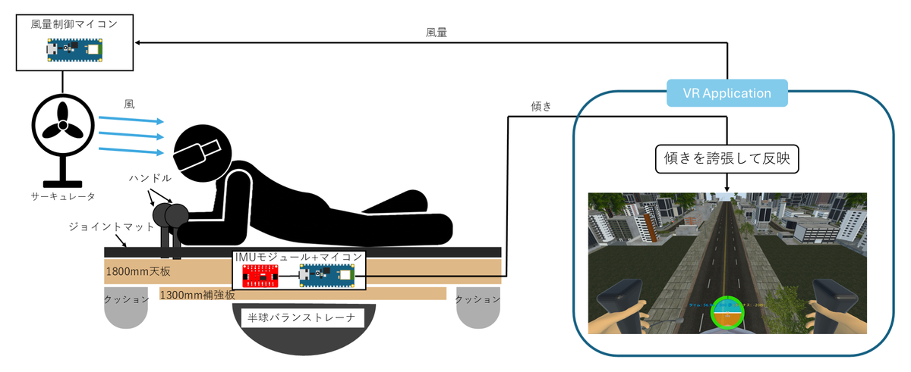
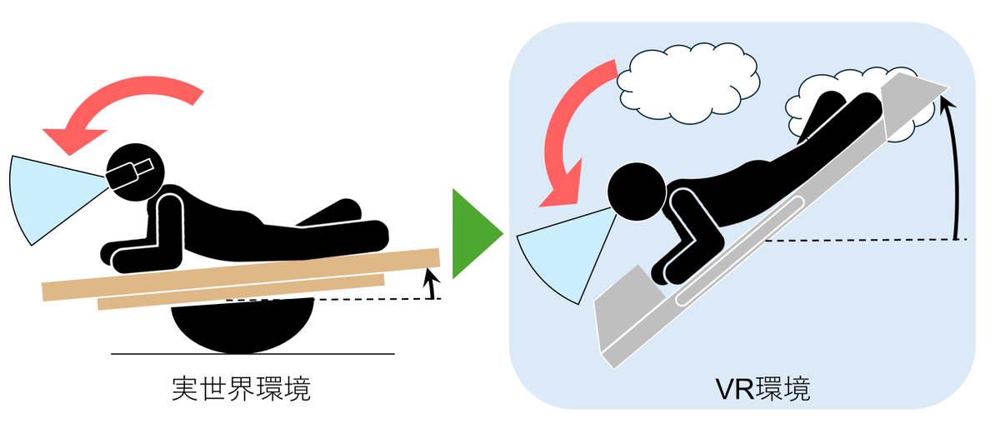

# SKY HIGH!!! ザ・VR・フライト

巨大なバランスボードにうつ伏せで乗り，重心を動かして空を飛ぶVR体験です。



この映像は開発中に動作を確認したときのもので，ゲーム画面をモニターに映しています。本番ではMeta Quest 3を付けて遊びますが，モニターでも遊べるようにしています（理由は[後述](#ヘッドセットがなくても遊べるようにする)）。

> **このリポジトリについて**
>
> 研究室のチーム開発プロジェクト（2026年2〜5月）のうち，私が担当したプログラムと設計を説明するリポジトリです。
> コードは研究室のリポジトリで管理しているため，ここには載せていません。主な処理は，本文中に一部を抜き出して載せています。

## 概要

- 直径180cmのバランスボードにうつ伏せで乗り，体の傾きで機体を操作します
- 前に傾くと下降・加速，後ろに傾くと上昇・減速，左右に傾くと旋回します
- 機体の速度に合わせてサーキュレータで風を送り，エリアの切り替えに合わせて匂いを出します
- リングを通過するとタイムが3秒縮み，最終タイムを競います

## システム構成



- **傾き**：天板に取り付けた姿勢センサー（IMU，BNO086）の値をマイコンがI2Cで読み取り，姿勢（Quaternion）としてWi-Fi経由のWebSocketでVRアプリへ送ります。VRアプリはUnityで作り，Meta Quest 3上で動かしています
- **風量**：VRアプリが機体の速度から風量レベル（25〜75）を決めて，TCPで風量制御用のマイコンへ送ります。マイコンはそれを受けて，赤外線リモコンの信号でサーキュレータの風量を変えます
- マイコンは2台ともArduino Nano ESP32です

## チームと担当

研究室の同期8名で開発しました（プログラマー3名・デバイス班3名・モデラー2名）。

**私が担当したもの**
- **機体の操作**：ボードの傾きをESP32で読み取ってUnityへ送り，機体の向き・旋回・速度を決める処理と，VR酔いを抑える工夫
- **風の演出**：機体の速度に合わせてサーキュレータの風量を変える処理（Unityでの風量の計算・送信と，ESP32でのサーキュレータの操作）
- **画面の表示**：水平儀・スピードリングなどの計器，逆走警告

バランスボードや匂いの装置の製作，3Dモデル，コース・リング・タイムなどのゲーム進行に関わる部分，チュートリアル，描画の最適化などは，他のメンバーが担当しました。

## 担当したプログラム

| ファイル | 内容 |
|------|------|
| `imu_websocket_sender.ino` | BNO086から姿勢（Quaternion）を読み取り，WebSocketでUnityへ送る。接続状態を確認するWebページも用意 |
| `wind_ir_controller.ino` | Unityから風量レベルを受け取り，リモコンの赤外線信号でサーキュレータの風量を変える |
| `GliderController.cs` | キーボード操作で飛行の動きを確かめたプロトタイプ |
| `VR_GliderController.cs` | 本番版。ボードの傾きを受け取り，機体の向きと速度に反映する。VR酔い対策，機体を所定の位置に戻して操作を再開する処理（リスポーン），風量制御との連携もここで実装 |
| `HUDController.cs` | 水平儀とスピードリングの表示 |
| `TiltbarUI.cs` | 機体の傾きを表示するバー |
| `WindControllerUDP.cs` | 風量送信の初期版。速度を風量レベル（25〜75）に変換し，値が変わったときだけマイコンへ送る。最初はUDPで作り，のちに通信をTCPに変えたため，名前にUDPが残っている |
| `WindControllerTCP.cs` | 風量送信の最終版。接続を保ったまま送り，切れたら再接続する。プレイが終わると風量を最小に戻す |
| `WrongWayWarning.cs` | 逆走の度合いに応じて，警告UIの透明度と警告音の音量を変える |

## 設計で工夫したこと

以下のコードは，説明のために一部を抜き出したものです。コメントを日本語で書き足し，ログ出力などは省いています。

### ヘッドセットがなくても遊べるようにする

もともとはVRゲームとして企画し，学外の体験イベント「いばらき×立命館DAY」での展示を目標にしていました。ただ，このイベントは子どもの参加者が多く，ヘッドセットを付けられない人が出ることが予想されます。VR酔いも起きやすい内容なので，酔った人がモニターで続きを遊べるようにもしておきたいと考えていました。

傾きの読み取りには，Meta Questのコントローラーをボードに固定し，その位置から傾きを求める案もありました。しかしそれではヘッドセットを使わないときに同じ操作ができないため，ボードにセンサーを取り付ける形にしています。実際，体験イベントでは，ヘッドセットを付けられない人や酔った人にモニターで遊んでもらいました。

### 飛行の動きをプロトタイプで先に固める

まずキーボード操作の試作版で飛行の動きを固めてから，センサーで操作するVR版へ移しました。動きを先に決めておいたので，うまく動かないときに，原因が通信側にあるのか飛行制御側にあるのかを切り分けやすくなりました。

### 基準の向きを設定する（キャリブレーション）

体験開始時のボードの向きを基準にして，そこから今どれだけ傾いているかを計算します。

```csharp
Quaternion relativeRot = Quaternion.Inverse(calibrationQuaternion) * currentIMURotation;
```

### 市販のサーキュレータをリモコンの信号で動かす

サーキュレータ本体には手を加えず，リモコンのボタン（電源・風量＋・風量−）の赤外線信号を記録しておき，ESP32につないだ赤外線LEDから同じ信号を出しています。

Unity側では，機体の速度を風量レベルに変換します。毎フレーム送るのではなく，値が変わったときだけ送るようにして，通信の回数を抑えています。

```csharp
// 速度を25〜75の風量レベルに変換する
float normalized = Mathf.InverseLerp(minSpeed, maxSpeed, currentSpeed);
int windLevel = Mathf.Clamp(Mathf.RoundToInt(normalized * 50) + 25, 25, 75);

// 前回と変わったときだけマイコンへ送る
if (windLevel != lastWindLevel)
{
    SendMessageToMicro(windLevel.ToString());
    lastWindLevel = windLevel;
}
```

赤外線は一方通行なので，サーキュレータが今どの風量になっているかは分かりません。そこでESP32側で現在の段階を覚えておき，Unityから届いた目標値になるまで，＋か−の信号を1回ずつ送るようにしています（風量制御マイコンの初期版のコードより）。

```cpp
// 目標の段階になるまで，＋か−の信号を1回ずつ送る
if (currentLevel < targetLevel) {
  sendIR(button2, 24, "プラス");
  currentLevel++;
}
else if (currentLevel > targetLevel) {
  sendIR(button3, 24, "マイナス");
  currentLevel--;
}
```

### 現場で接続状態を確かめられるようにする

姿勢の送信は最初UDPで作り，のちにWebSocketへ切り替えました。UDPは送りっぱなしで相手とつながっているかが分かりませんが，WebSocketは接続を保ったまま送るので，ESP32側で接続の状態を把握できます。そこで，状態確認用のWebページも用意しました。ブラウザで開くと，接続中かどうか，最後に送ってから何秒たったか，切断した回数，Wi-Fiの電波の強さが表示され，2秒ごとに更新されます。展示中に通信が切れても，その場で状態を確かめられるようにするためです。

### 体の傾きを誇張して機体に反映する



ボード自体は最大でも約7度しか傾きませんが，VR内ではこれを誇張して，前は最大60度，後ろは30度，左右は45度まで機体を傾けています。体を少し傾けるだけで，機体が大きく傾いて飛んでいるように感じられます。

```csharp
// ボードの傾きを，想定する最大の傾きに対する割合（-1〜1）にする
float pitchRatio = Mathf.Clamp(rawPitch / maxPhysicalPitchAngle, -1f, 1f);
float rollRatio = Mathf.Clamp(rawRoll / maxPhysicalRollAngle, -1f, 1f);

// 前に傾けたとき（下降）と後ろに傾けたとき（上昇）で，上限と感度を切り替える
float currentPitchSens = (pitchRatio > 0) ? pitchDownSensitivity : pitchUpSensitivity;
float currentMaxP = (pitchRatio > 0) ? maxPitchDownAngle : maxPitchUpAngle;

// 割合に上限の角度を掛けて，機体の目標の角度にする
targetPitch = pitchRatio * currentMaxP * currentPitchSens;
targetRoll = rollRatio * maxRollAngle * rollSensitivity;
```

機体は自動で前に進み（時速100〜400km），前に傾けると下降しながら加速し，後ろに傾けると上昇しながら減速します。速度は`Lerp`で基準の速さに少しずつ戻るようにして，空気抵抗のような感覚を出しています。

### VR酔い対策

VR酔いは開発を通して大きな課題で，主に次のような対策をしています。

- 機体モデルは大きく傾けますが，カメラの左右の傾き（Roll）は`cameraRollMultiplier`で弱め，視界が回りすぎないようにしています
- 目標の角度へは`Mathf.Lerp`で少しずつ近づけ，視界が急に動かないようにしています
- 機体の前後の傾き（Pitch）と左右の傾き（Roll）には上限を設け，一回転しないようにしています
- リスポーン時は，フェードアウト→位置のリセット→フェードイン→カウントダウンの順に進め，いきなり操作が始まらないようにしています（Coroutineで実装）

カメラと機体モデルの傾きは，次のように分けています。

```csharp
// カメラ側には左右の傾きの一部（cameraRollMultiplier = 0.5）だけを加える
float appliedCameraRoll = enableCameraRoll ? (currentRoll * cameraRollMultiplier) : 0f;
Quaternion baseRotation = Quaternion.Euler(currentPitch, currentYaw, appliedCameraRoll);
rb.MoveRotation(baseRotation);

// 残りの傾きは機体モデルだけに加え，見た目では大きく傾ける
gliderModel.localRotation = Quaternion.Euler(0f, 0f, currentRoll - appliedCameraRoll);
```

傾きから機体の角度への変換は，体験会の意見を見ながら何度も作り直しました。前後で上限と感度を別々にして上昇側の上限を小さくしたり，センサーの取り付けのずれを補正するオフセットを入れたりしています。小さな傾きでは反応を抑え，大きな傾きでは強める指数カーブ（`Mathf.Pow(Mathf.Abs(ratio), 1.5f)`）や，1度未満の傾きを無視するデッドゾーンも試しましたが，最終的には，ボードの傾きに比例した角度を目標にして`Lerp`でなめらかに近づける形に落ち着きました。

### バンク旋回

左右に傾けると，その傾き（Roll）に応じて機体の向き（Yaw）が少しずつ回ります。飛行機のように，機体を傾けながら曲がる動きになります。

```csharp
// 左右の傾きに比例して，機体の向きを少しずつ回す
float yawTurn = -currentRoll * yawTurnSpeed * Time.fixedDeltaTime;
currentYaw += yawTurn;
```

## 開発の流れと体験会での改善

研究室では報告会が4回（2/16・3/9・3/30・4/27）あり，後半の2回は体験会を兼ねていました。体験会と学外の体験イベント（5/17）では毎回アンケートを取り，次の改善に使いました。私の担当部分での主な変更は次のとおりです。

**3/9の報告会まで**（ボードの完成前）
- キーボード操作の試作版で，自動前進・上昇・下降・旋回といった飛行の基本の動きを作成
- ESP32でセンサーの姿勢を読み取り，Wi-Fiで送れることを確認

**3/30の体験会まで**
- 試作版の飛行の動きをVR版へ移植し，ボードのセンサーの値（UDPで受信）で機体を動かせるように
- ボードの傾きを誇張して機体に反映し，上昇方向の角度は小さめに制限
- 左右の傾きを旋回に変換（バンク旋回）
- 酔い対策として，カメラと機体の傾きの分離，角度の上限，指数カーブ，リスポーン時のフェードとカウントダウンを追加
- 水平儀を追加

**3/30の体験会のあと**

アンケートを受けて，チームでコンセプトを「ウイングスーツで飛ぶ形」から「グライダーのような機体（メーヴェ型）に乗って飛ぶ形」に変えました。その後の私の担当部分での変更は次のとおりです。

- 機体モデルの追加に合わせて，いったん止めていたカメラの左右の傾きを再び有効化
- センサーの傾きのずれを補正する機能を追加
- 進む方向を示すガイドを，速度に応じて弧を描く形に変更
- サーキュレータをリモコンの赤外線信号で操作し，機体の速度に合わせて風量を変える仕組みを追加
- 画面下の傾き・速度のメーターを，前後左右の傾きと速度が分かる表示に変更

**4/27の体験会のあと**
- 逆走警告のUIを追加

**いばらき×立命館DAY 2026（5/17）**

延べ約60名に体験してもらい，アンケートの平均は次のようになりました。

| 項目 | 平均（5段階） |
|------|------|
| 楽しさ | 4.7 |
| リアリティ | 3.9 |
| 酔いにくさ（5＝全く酔わない） | 4.1 |

一方で，「操作が難しい」「左右の感度が高すぎる」という声もありました。

## 学会発表・受賞

チーム開発のあと，このシステムをもとに，うつ伏せの姿勢で実際より大きく傾いたように感じる「傾斜錯覚」を題材にしたデモ論文を発表しました。論文の版では，操作を前後の傾きだけに制限しています。

- **ヒューマンインタフェースシンポジウム2026**：デモ論文「SKY HIGH!!!：腹臥位における傾斜錯覚を利用したVR飛行体験」（筆頭著者）で**優秀プレゼンテーション賞**を受賞（[受賞者一覧](https://jp.his.gr.jp/symposium/award2026/)，発表番号1T-D15W）
- **VRST 2026**（ACM Symposium on Virtual Reality Software and Technology）：デモ論文「[SKY HIGH!!!: A VR Flight Experience Using Tilt Illusion in a Prone Posture](https://doi.org/10.1145/3822517.3849972)」（第2著者）

VRSTのデモ論文に添えて提出した補足動画です。

[](https://www.youtube.com/watch?v=oDBCvlq0hIE)

## 展示

- いばらき×立命館DAY 2026（2026年5月）
- 立命館大学 オープンキャンパス（2026年8月）
- RITSUMEIKAN GLOBAL WEEK 2026（2026年11月）

## 開発環境

- Unity 2022.3.52f1 / C#
- Meta Quest 3
- Arduino Nano ESP32 / BNO086（SparkFun VR IMU Breakout）
- WebSocket：Unity側は.NET標準の`ClientWebSocket`，ESP32側は`WebSocketsServer`（arduinoWebSockets）
- IMUの読み取り：SparkFun BNO08x Arduino Library
- 赤外線の送信：IRremote
